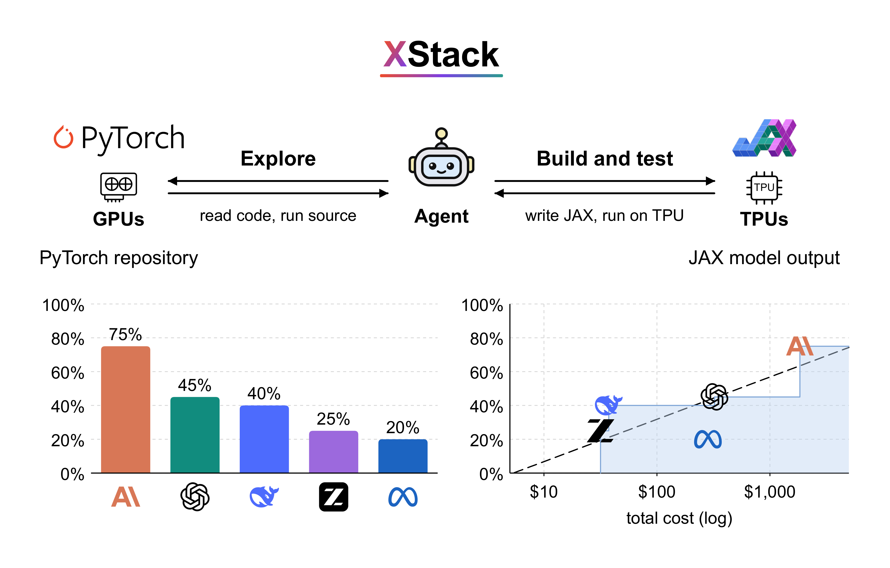

<div align="center">

# XStack

### A Benchmark for ML Repo Migration

Linrong Cai &nbsp;·&nbsp; Taiming Lu &nbsp;·&nbsp; Haozhe Chen &nbsp;·&nbsp; Zhuang Liu

Princeton University

[](https://arxiv.org/abs/2611.08472)
[](https://huggingface.co/datasets/zlab-princeton/XStack)

</div>

XStack tests whether a coding agent can migrate a working machine-learning system across
frameworks and hardware. Each of the 20 tasks is a real PyTorch repository at a fixed
commit; the agent gets the source, a bare TPU machine and one prompt, and must hand in a
JAX repository that reproduces the source's published result at its own scale, without
being told the metric, the bar or the dataset.



We ran seven coding agents on real TPUs: Claude Opus 5 passes 75% of the repositories,
GPT-5.6-sol 45%, and every other agent at most 40%. Agents can complete these migrations
but still struggle to verify that what they built is faithful, complete and works end to
end, and pass rate grows linearly with the log of an agent's cost.

The [dataset](https://huggingface.co/datasets/zlab-princeton/XStack) holds the 20 tasks, every run with
its transcript and verdicts, and the migrations the agents handed in.

## How it works

One cell is one agent on one task.

1. **Prompt.** The agent gets the source tree, the prompt and the access document of a
   TPU machine it sets up itself. It hands in the migrated repository with
   `setup_env.sh`, `run_train.py` and `export_torch.py`.
2. **Grade.** A fresh machine runs the submission at full scale. Its headline number is
   compared with a bar taken from the source's published result, and the exported
   weights must load into the source model.
3. **Judge.** Two judges read the transcript and the diff of every pass, one for the
   recipe and one for cheating. Each runs three times; one fail decides.
4. **Phase 2.** A failed blind turn gets one more turn with the code frozen: only
   `run_train.py` may change, and the recipe is now stated.

## Layout

```
tasks/<repo>/        task.yaml, criteria.json (hidden), prompt.md, phase2.md
prompts/             the phase-1 and phase-2 templates, the fail messages, the three judge prompts, the failure taxonomy
harness/
  phase1.sh            run one cell: the blind turn
  phase2.sh            the frozen phase-2 turn of a failed cell
  run_cell.sh          the driver both call
  grade.sh             grade a submission on a fresh TPU machine
  agents/              the agent launchers: codex.sh, claude.sh
judges/              judge_verdict.py (the correctness and cheat judges), failure_judge.py (the failure judge)
fetch_sources.py     clone every task's source at its pinned commit
config.env.example   copy to config.env: work directory, TPU machine, ssh user and key
```

## Install

```bash
uv venv --python 3.11 .venv && source .venv/bin/activate
uv pip install numpy torch               # torch runs the weight-load check of a passing submission
python fetch_sources.py               # tasks/<repo>/source_torch at the pinned commits
cp config.env.example config.env      # the work directory and the TPU VM; gcloud logged in
```

## Agents

The driver calls an agent CLI with the prompt inside a read-masking sandbox (`bwrap`),
so the agent sees its workspace and its machine and nothing else.

- **Codex** is the default: `codex login`, then run a cell.
- **Claude Code**, and any provider with an Anthropic-compatible endpoint (GLM, DeepSeek,
  Muse, Kimi): put `XSTACK_AGENT_TOKEN`, and for a third-party provider
  `XSTACK_AGENT_BASE_URL` and `XSTACK_AGENT_MODEL` (optionally `XSTACK_AGENT_DISALLOWED`,
  claude's `--disallowedTools`), in
  `$XSTACK_WORK/secrets/<provider>.env` (`anthropic.env`, `zai.env`, `deepseek.env`,
  `meta.env`, `kimi.env`; the model label picks the file), then run a cell with
  `XSTACK_AGENT_KIND=claude XSTACK_AGENT_LAUNCHER=harness/agents/claude.sh`.

The judges run on Codex; `XSTACK_JUDGE_MODEL` and `XSTACK_JUDGE_EFFORT` pick the model and
effort (the paper's are gpt-5.6-sol at medium).

## Run one cell

```bash
bash harness/phase1.sh nanogpt gpt-5.6-sol high          # blind turn
bash harness/phase2.sh nanogpt gpt-5.6-sol high          # frozen phase 2, after a FAIL
python judges/judge_verdict.py --cell results/run1/gpt-5.6-sol_high/nanogpt
python judges/failure_judge.py results/run1/gpt-5.6-sol_high/nanogpt
```

One TPU VM per concurrent cell; the machine is wiped before the agent starts and again
before grading. The cell directory `results/<run>/<model>_<effort>/<repo>/` (`XSTACK_RUN` names
the run, default `run1`) receives the access document, the transcript, the submission, the
grade log and metrics of each turn, `turns.jsonl` with the verdicts, and the judges' answers.

## Tasks

| task | domain | source |
|---|---|---|
| `mingpt` | language modeling | [minGPT @ 37baab7](https://github.com/karpathy/minGPT/tree/37baab71b9abea1b76ab957409a1cc2fbfba8a26) |
| `makemore` | language modeling | [makemore @ 988aa59](https://github.com/karpathy/makemore/tree/988aa59e4d8fefa526d06f3b453ad116258398d4) |
| `lora` | fine-tuning | [LoRA @ c4593f0](https://github.com/microsoft/LoRA/tree/c4593f060e6a368d7bb5af5273b8e42810cdef90) |
| `ast` | audio classification | [AST @ 31088be](https://github.com/YuanGongND/ast/tree/31088be8a3f6ef96416145c4b8d43c81f99eba7a) |
| `x_transformers` | language modeling | [x-transformers @ dfd829b](https://github.com/lucidrains/x-transformers/tree/dfd829b8c1e291ad03c95f509fc874d55f3da40d) |
| `llama2c` | language modeling | [llama2.c @ 350e04f](https://github.com/karpathy/llama2.c/tree/350e04fe35433e6d2941dce5a1f53308f87058eb) |
| `modded_nanogpt` | language modeling | [modded-nanoGPT @ 1b51e26](https://github.com/KellerJordan/modded-nanogpt/tree/1b51e26d304f647c7c12201b3f1513ee5a429ec4) |
| `airbench` | image classification | [airbench @ 4c1b6d1](https://github.com/KellerJordan/cifar10-airbench/tree/4c1b6d1e3889b037efadcfd5c0ea65b246592362) |
| `simcse` | sentence embeddings | [SimCSE @ 49fa580](https://github.com/princeton-nlp/SimCSE/tree/49fa580a853752ede55b8c76d9debf748e214d3f) |
| `generative_recommenders` | recommendation | [HSTU @ fb0ba64](https://github.com/meta-recsys/generative-recommenders/tree/fb0ba644be8dd1c7b072199c9c8bc6ce3adaf3d8) |
| `s4` | long-sequence modeling | [S4 @ e757cef](https://github.com/state-spaces/s4/tree/e757cef57d89e448c413de7325ed5601aceaac13) |
| `tdmpc2` | reinforcement learning | [TD-MPC2 @ e9f5932](https://github.com/nicklashansen/tdmpc2/tree/e9f59321933cbc8e11a002b842adc7d4ffae8ff1) |
| `nanochat_core` | language modeling | [nanochat @ dc54a1a](https://github.com/karpathy/nanochat/tree/dc54a1a3077cab11d68fac4c5d1cd5c51f5d8c7a) |
| `tensorf` | neural fields | [TensoRF @ 6a1e23b](https://github.com/apchenstu/TensoRF/tree/6a1e23b10b9521221049aec843ab370a747a7982) |
| `nanogpt` | language modeling | [nanoGPT @ 3adf61e](https://github.com/karpathy/nanoGPT/tree/3adf61e154c3fe3fca428ad6bc3818b27a3b8291) |
| `nanovlm` | vision-language | [nanoVLM @ 6ba9082](https://github.com/huggingface/nanoVLM/tree/6ba9082e16f1fc8c21a1f8d0c54b26c9233c8771) |
| `deepspeech` | speech recognition | [deepspeech @ b88a631](https://github.com/SeanNaren/deepspeech.pytorch/tree/b88a631ef6b96553e16bbaa5bd6a621435bed278) |
| `tgn` | temporal graph learning | [TGN @ d55bbe6](https://github.com/twitter-research/tgn/tree/d55bbe678acabb9fc3879c408fd1f2e15919667c) |
| `patchtst` | time-series forecasting | [PatchTST @ 204c21e](https://github.com/yuqinie98/PatchTST/tree/204c21efe0b39603ad6e2ca640ef5896646ab1a9) |
| `tabr` | tabular learning | [TabR @ 17baa90](https://github.com/yandex-research/tabular-dl-tabr/tree/17baa9082506f8e7a0f8d11bb1e08212926a1507) |

`criteria.json` holds what is graded and the bar; the agent never sees it. To add a
task, copy a neighbour's `task.yaml` and `criteria.json` and run
`python harness/render_prompts.py <repo>`.

## Citation

```bibtex
@article{cai2026xstack,
  title={XStack: A Benchmark for ML Repo Migration},
  author={Cai, Linrong and Lu, Taiming and Chen, Haozhe and Liu, Zhuang},
  journal={arXiv preprint arXiv:2611.08472},
  year={2026}
}
```
